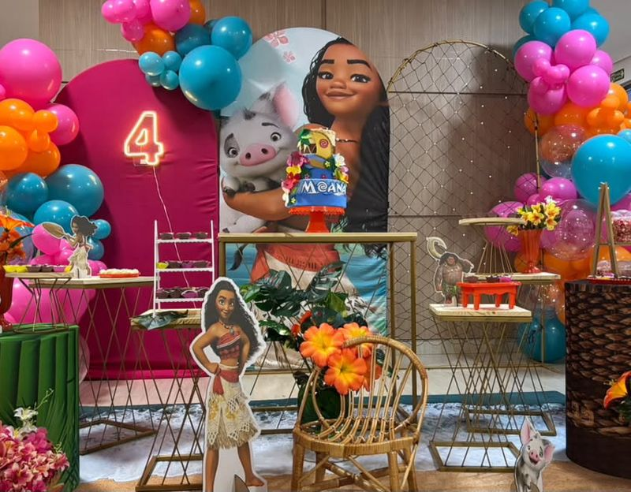

<div align="center">
  

  # Amora Festas

  **Landing page para locação de brinquedos, decoração de festas e kits Pegue e Monte em Guarulhos — SP.**

  
  
  
  

  
</div>

## ✨ Sobre o projeto

Este projeto é um site estático responsivo desenvolvido para divulgar os serviços da **Amora Festas**, com foco em uma apresentação bonita, rápida e fácil de acessar pelo celular.

A página permite que os visitantes conheçam os serviços e iniciem uma conversa diretamente pelo WhatsApp.

## 🎉 Serviços

- 🎈 **Locação de brinquedos** — piscina de bolinhas, cama elástica e combos.
- 🌸 **Decoração completa** — planejamento, montagem e desmontagem.
- 📦 **Kit Pegue e Monte** — painel, cilindros, mesa e acessórios decorativos.
- 💬 **Orçamento pelo WhatsApp** — mensagens pré-formatadas para cada serviço.

## 🛠️ Tecnologias

- **HTML5** para estrutura e conteúdo
- **Tailwind CSS** para estilos responsivos
- **JavaScript** para menu mobile, FAQ e integração com WhatsApp
- **Lucide** para ícones
- **GitHub Pages, Netlify ou Cloudflare Pages** para publicação

## 📁 Estrutura

```text
amora-festas/
├── index.html
├── css/
│   ├── input.css
│   └── style.css
├── js/
│   ├── main.js
│   └── vendor/
│       └── lucide.min.js
├── img/
├── tailwind.config.js
├── _headers
└── .htaccess
```

## 🚀 Como visualizar

### Opção rápida

Abra o arquivo `index.html` diretamente no navegador.

### Com servidor local

```bash
npx serve .
```

Depois, acesse o endereço exibido no terminal.

## ✏️ Personalização

### Conteúdo e serviços

Edite os textos e seções em `index.html`. Os comentários indicam partes como `<!-- HERO -->`, `<!-- SERVIÇOS -->`, `<!-- GALERIA -->` e `<!-- FAQ -->`.

### WhatsApp

Altere o número em `js/main.js`:

```js
whatsapp: '5511945327850',
```

Use somente dígitos, incluindo o código do país:

```text
55 + DDD + número
```

A mensagem de cada botão pode ser personalizada pelo atributo `data-wa` em `index.html`.

### Fotos

Adicione novas imagens na pasta `img/` e atualize o atributo `src` correspondente em `index.html`.

> **Dica:** use imagens leves em formato JPG ou WebP e inclua sempre uma descrição clara no atributo `alt`.

### Cores e fontes

As cores e fontes do tema ficam em `tailwind.config.js`. A folha de estilos final é `css/style.css`.

## 🔒 Segurança

- Política de Segurança de Conteúdo definida no `<head>` do `index.html`
- Scripts e estilos externos controlados por CSP
- Ícones hospedados localmente
- Links externos configurados com `noopener noreferrer`
- Cabeçalhos adicionais disponíveis em `_headers` e `.htaccess`

Se novos serviços externos forem adicionados ao site, atualize também as regras de CSP.

## 🌐 Publicação

### GitHub Pages

1. Faça o envio dos arquivos para o repositório no GitHub.
2. Abra **Settings → Pages**.
3. Selecione a branch `main` e a pasta raiz.
4. Acesse o endereço publicado pelo GitHub Pages.

> Os arquivos `.htaccess` e `_headers` não são aplicados pelo GitHub Pages. A política CSP presente no HTML continua ativa.

### Netlify ou Cloudflare Pages

Conecte o repositório à plataforma e use a raiz do projeto como diretório de publicação. O arquivo `_headers` será aplicado automaticamente.

### Hospedagem Apache

Envie os arquivos por FTP e mantenha o `.htaccess` na raiz do projeto.

## ✅ Antes da publicação

- [ ] Confirmar os preços dos serviços
- [ ] Conferir o horário de funcionamento
- [ ] Substituir depoimentos fictícios por avaliações reais
- [ ] Trocar fotos ilustrativas por fotos reais das festas
- [ ] Revisar prazos e regras do FAQ
- [ ] Definir a URL final e configurar as tags Open Graph

## 📞 Contato

- **WhatsApp:** [(11) 94532-7850](https://wa.me/5511945327850)
- **WhatsApp:** [(11) 97301-7815](https://wa.me/5511973017815)
- **WhatsApp:** [(11) 99431-6046](https://wa.me/5511994316046)
- **Instagram:** [@amorafestas9](https://instagram.com/amorafestas9)

---

<div align="center">
  Feito para transformar momentos em memórias inesquecíveis.
</div>